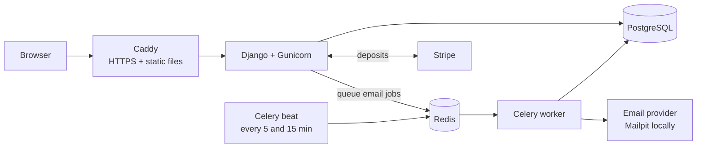

# Clinic Booking Platform

A containerised booking system for a service business. Customers browse treatments and prices, book an available time slot, and receive an automatic email confirmation with a calendar invite. The demo is themed as a fictional laser clinic, *Clearline Laser Studio*.

> **Status:** working prototype (v0.9). Everything below runs locally with one command. Going live needs a server, a domain and a real email provider: see [docs/going-live.md](docs/going-live.md).

## Features

- **Treatments, prices and shop:** managed from the admin panel, no code changes needed
- **Booking flow:** choose a treatment, a day and a time, then confirm (HTMX, no page reloads)
- **Availability engine:** builds free slots from opening hours, closed days, treatment length, clean-down buffer, minimum notice and existing bookings
- **No double-booking:** a Postgres exclusion constraint makes overlapping bookings impossible, backed by a locked transaction and a concurrency test
- **Automated emails:** confirmation with an `.ics` calendar invite, reminder the day before, cancel/reschedule notices and owner alerts, sent in the background with automatic retries
- **Manage my booking:** clients cancel or move their booking through a signed link, no login needed
- **Deposits (optional):** Stripe Checkout with a webhook. With no Stripe keys, deposits are taken in clinic
- **Owner dashboard:** bookings this week, utilisation, revenue, cancellation and no-show rates, bookings by treatment and by marketing source
- **Campaign tracking:** `?utm_source=tiktok` on an ad link is saved against the booking
- **CSV export:** every booking with price, lead time, status and source, ready for forecasting (e.g. a Monte Carlo model)
- **Fully containerised:** web, worker, scheduler, database, Redis and a test inbox start with one command

## Tech stack

| Layer | Tool |
|---|---|
| Web framework | Django 5.2 (Python 3.12) |
| Database | PostgreSQL 16 |
| Background jobs | Celery + Redis (worker and beat) |
| Frontend | Django templates, HTMX, hand-written CSS (no build step) |
| Serving | Gunicorn + Caddy (automatic HTTPS) |
| Containers | Docker, Docker Compose |
| Local email testing | Mailpit |
| Payments | Stripe Checkout (optional) |
| Monitoring | `/health/` endpoint, Sentry (optional) |
| CI/CD | GitHub Actions: ruff, pytest, build and push to GitHub Container Registry |

## Architecture



More detail in [docs/architecture.md](docs/architecture.md).

## Getting started

**You need:** [Docker Desktop](https://www.docker.com/products/docker-desktop/) installed and open.

```bash
git clone https://github.com/rubendasilv/clinic-booking-platform.git
cd clinic-booking-platform
cp .env.example .env
docker compose up --build
```

The first start takes a few minutes. When the logs show `Starting development server at http://0.0.0.0:8000/`, open:

| Service | URL |
|---|---|
| Website | http://localhost:8000 |
| Admin panel | http://localhost:8000/admin (login `admin` / `clearline-demo`) |
| Owner dashboard | http://localhost:8000/dashboard |
| Test inbox (Mailpit) | http://localhost:8025 |
| Health check | http://localhost:8000/health/ |

Demo treatments, prices, products, opening hours and 120 fake bookings are loaded automatically. Set `SEED_DEMO=0` in `.env` to switch that off.

Stop everything with `Ctrl+C`, or `docker compose down`. Add `-v` to also delete the database.

New to the terminal? Follow the step-by-step guide in [docs/beginners-guide.md](docs/beginners-guide.md).

### Useful commands

```bash
docker compose run --rm web pytest                      # run the tests
docker compose run --rm web ruff check .                # lint
docker compose exec web python manage.py createsuperuser
docker compose exec web python manage.py seed_demo      # reload demo prices
docker compose logs -f worker                           # watch emails being sent
```

## Data for forecasting

Logged-in staff can download:

- `/dashboard/export/bookings.csv`: one row per booking with `created_at`, `start`, weekday, hour, `lead_time_days`, treatment, price, deposit, status (completed, no-show, cancelled…), `utm_source` and whether the client is returning
- `/dashboard/export/services.csv`: prices, durations, buffers and opening hours (the capacity side of a model)

The demo data is generated, not real. It's useful for building and testing a model, not for drawing conclusions about the business.

## Project layout

```
config/            settings, URLs, Celery app
bookings/
  models.py        Service, Product, OpeningHours, ClosedDay, Customer, Booking
  slots.py         availability engine (pure function + database wrapper)
  actions.py       create / cancel / reschedule / mark paid (all rules live here)
  tasks.py         background emails, reminders, expiring unpaid holds
  emails.py, ics.py
  payments.py      Stripe Checkout + webhook
  analytics.py     dashboard numbers and CSV export
  tests/           pytest suite (slots, double-booking, emails, views, payments)
docker/            entrypoint and Caddyfile
compose.prod.yml   production stack
scripts/backup.sh  nightly pg_dump
```

## Roadmap

- [x] Foundations in containers
- [x] Booking engine
- [x] Automated emails (MVP)
- [x] CI pipeline and production compose file
- [ ] Deploy to a VPS with a domain and HTTPS
- [ ] Real email provider with SPF, DKIM and DMARC
- [ ] Demo video and write-up

**Stretch goals:** ~~Stripe deposits~~, ~~bookings analytics dashboard~~, Kubernetes manifests, selling shop items online.

## Author

**Ruben Da Silva Sequeira** · [LinkedIn](https://www.linkedin.com/in/ruben-da-silva-/) · [GitHub](https://github.com/rubendasilv)

## License

[MIT](LICENSE)
