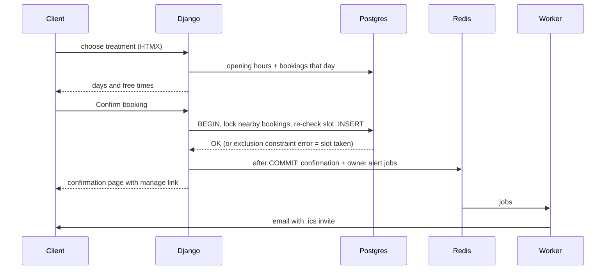
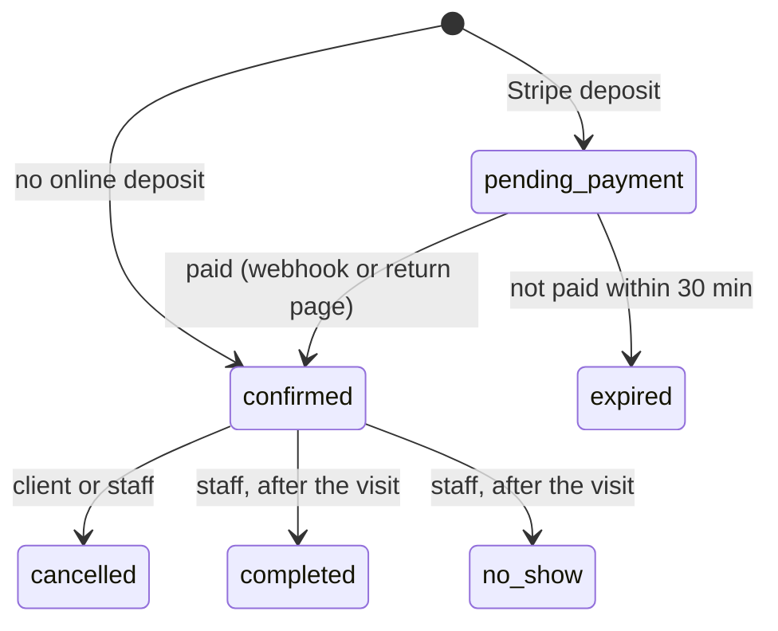

# Architecture

## Containers

| Service | Image | Job |
|---|---|---|
| `web` | this repo | Django. `runserver` locally, Gunicorn in production. Runs migrations on start. |
| `worker` | this repo | Celery worker. Sends every email so the website never waits on the email provider. |
| `beat` | this repo | Celery beat. Every 15 min queues reminders; every 5 min frees unpaid holds. |
| `db` | postgres:16-alpine | All data. |
| `redis` | redis:7-alpine | Job queue between `web`/`beat` and `worker`. |
| `mailpit` | axllent/mailpit | Local only. Catches all email at http://localhost:8025. |
| `caddy` | caddy:2-alpine | Production only. HTTPS certificates, static files, proxy to `web`. |

`web`, `worker` and `beat` share one image, so they always run the same code.

## A booking, step by step

## How double-booking is prevented

Three layers, each enough on its own for the normal case:

1. **Availability check:** the slot is recalculated inside the transaction just before saving.
2. **Row locks:** `select_for_update()` locks live bookings around the chosen time, so two requests queue instead of both passing the check.
3. **Database constraint:** an `ExclusionConstraint` on `tstzrange(start, blocks_until)` with `&&` (overlaps) means Postgres itself rejects any two live bookings whose times, including the clean-down buffer, overlap. This also covers staff adding bookings in the admin.

`test_two_people_booking_at_once_only_one_wins` fires two bookings for the same slot from two threads at the same moment and checks exactly one succeeds.

## Booking statuses

Only `pending_payment` and `confirmed` block the diary.

## Manage links

The link in each email is `signing.dumps({booking, customer})` with a salt and timestamp. It can't be guessed or edited, expires after 180 days, and needs no login or stored token.

## Settings

Everything that differs between laptop and server comes from `.env` (see `.env.example`). With `DJANGO_DEBUG=False`, secure cookies, HTTPS proxy headers and other hardening switch on.
